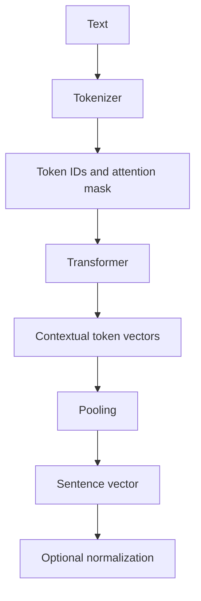
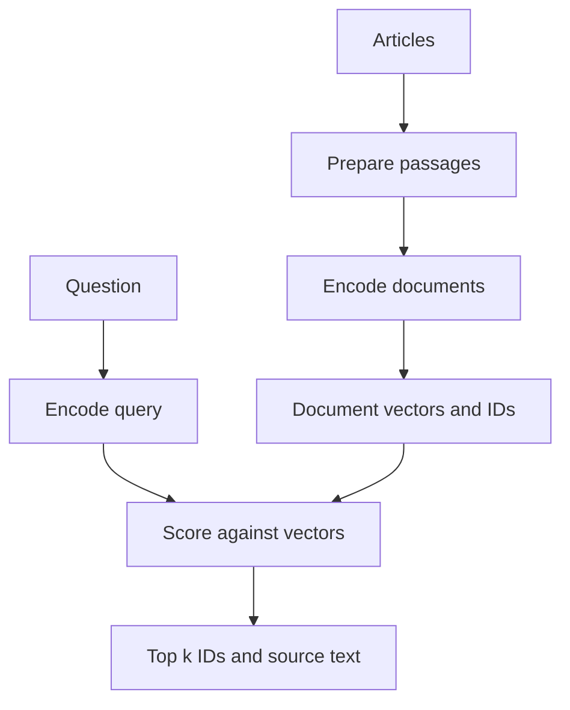

# Embeddings · From vectors to semantic search

## What you will be able to do

By the end of this chapter, you will be able to:

- explain what an embedding represents, how it is produced, and what proximity does and does not mean
- calculate cosine similarity and distinguish it from dot product and Euclidean distance
- generate local text embeddings and inspect their dimensions, norms, and similarity scores
- build a small semantic search system and diagnose failures involving chunking, identifiers, and missing answers
- compare retrieval configurations using labeled queries, Recall@k, and MRR@k
- describe the versioning, freshness, and permissions required around an embedding index

This chapter comes before [Module 3 · Retrieval, RAG & Memory](03-rag-memory.md). It assumes you can run Python and inspect a list or array; you do not need a vector database or an API key.

## 🔨 The build

**[`builds/03-embeddings-lab`](https://github.com/noufal85/ai-engineer-curriculum/tree/main/builds/03-embeddings-lab)** is a local lab with five examples: geometry, sentence pairs, support-article search, chunking, and retrieval evaluation. It includes 24 synthetic support articles and labeled queries. These are teaching fixtures, not a company's actual support policies.

Start with a dependency-free example from the repository root:

```bash
./.venv/bin/python builds/03-embeddings-lab/embeddings_lab.py --example geometry
```

Then follow the [embedding lab](../labs/03-embeddings.md) to install the local model and compare keyword search with semantic search. Run an example, predict the next result, change one input, and record what happened. The following sections explain the artifact you are running.

## 1 · Search by meaning

Imagine a support article titled “Reset your password.” Someone asks, “I forgot my sign-in secret; how do I get back into my account?” Exact word matching has limited evidence connecting the question and the title. A useful text embedding can represent some of that relationship despite the different wording.

The lab compares two ranking methods. Its keyword baseline counts overlap between sets of words; it is deliberately small and **is not BM25**. The embedding method compares learned vectors. Neither is guaranteed to win every query. An exact error code can be more useful than a broad paraphrase, and an embedding can retrieve something topically similar that answers a different question.

Try the search example after the lab's setup:

```bash
python builds/03-embeddings-lab/embeddings_lab.py --example search \
  --query "I forgot my password. How can I sign in again?" --top-k 3
```

Predict the relevant article before running it. Read the returned text, rather than accepting the highest score as proof. Then replace the question with an exact phrase from an article and compare the two rankings again.

## 2 · What is an embedding?

An embedding is a representation of an item as a vector: an ordered list of numbers. A text encoder maps text to a fixed-length vector. The vector's length is its **dimension**, not the number of words in the input. Many different texts therefore share the same vector shape.

Consider three representations:

| Representation | Coordinates mean | Main tradeoff |
|---|---|---|
| Manually designed features | Named properties such as text length and count of error codes | Easy to inspect; depends on features you invent |
| Sparse word features | Vocabulary terms, often with weights | Preserves lexical evidence; many coordinates are zero |
| Learned dense embedding | Features learned from a training objective | Can capture useful relationships across wording; coordinates are usually not individually interpretable |

A two-dimensional drawing labeled “billing” and “account access” can illustrate geometry. Those are **invented teaching coordinates**, not axes extracted from the lab model. A learned vector does not normally come with one coordinate per human concept.

“Near” is meaningful only in the context of a model, a similarity measure, and a task. An image embedding and a text embedding of the same length are not automatically comparable. Even two text models producing 384 numbers can define different spaces.

**Explain it back:** Why does a longer paragraph not necessarily produce a longer embedding? Why is equal dimension insufficient for comparing vectors from different models?

## 3 · From tokens to a sentence vector

The word “embedding” appears at several levels:

- **Static token or word embeddings** associate a vocabulary entry with a learned vector. The lookup itself does not change with the surrounding sentence.
- **Contextual token representations** depend on the surrounding text. The representation of “bank” can differ between a riverbank passage and a banking passage.
- **Sentence or passage embeddings** summarize an input into a vector intended for comparing complete texts.
- **Document embeddings** may encode a whole document within a model's input limit, or result from a separately chosen aggregation strategy. Averaging arbitrary chunk vectors is a design choice to evaluate.
- **Positional information** tells a sequence model about order. It is a different role from a final semantic search embedding; position may be represented through learned embeddings or other mechanisms.

A common sentence-encoder path looks like this:



Pooling turns several token vectors into one vector. Mean pooling averages the appropriate token representations, respecting the attention mask so padding does not distort the result. Other architectures use different pooling methods. Use the encoder's configured pipeline instead of extracting a random hidden state and assuming it is a good retrieval representation.

The lab uses `sentence-transformers/all-MiniLM-L6-v2`, whose model card specifies 384-dimensional vectors for sentences and short paragraphs. Its default pipeline truncates inputs longer than 256 word pieces. Word pieces are tokenizer units, not whitespace-separated words; inspect the actual tokenized input rather than guessing from a word count. See the [model card](https://huggingface.co/sentence-transformers/all-MiniLM-L6-v2).

## 4 · How the space is learned

The geometry is shaped during training. A contrastive objective can encourage related examples to have higher similarity than unrelated ones. For retrieval, a training example might pair a question with a passage that answers it and compare that pair against other passages.

A **positive** might be “How do I reset my password?” paired with password-reset instructions. An easy negative is an unrelated weather report. A **hard negative** could be instructions for changing an account email: similar vocabulary, different action. Useful negatives make the model learn finer distinctions, but a mislabeled negative can punish a valid relationship.

Training changes parameters using many examples. **Inference** applies the already trained encoder to new inputs; the lab performs inference. Adding an article to the corpus generates another vector but does not teach the model a new meaning. Domain adaptation or fine-tuning is a separate project with its own training data and evaluation.

Sentence-BERT provides a foundation for comparing sentence representations. Dense Passage Retrieval illustrates query and passage encoders trained for retrieval. These objectives explain why the training task matters more than the vague claim that a model “understands text.”

## 5 · Measure similarity deliberately

For vectors `a` and `b`:

```text
dot(a, b)     = sum(a[i] * b[i])
norm(a)       = sqrt(sum(a[i] ** 2))
cosine(a, b)  = dot(a, b) / (norm(a) * norm(b))
distance(a,b) = sqrt(sum((a[i] - b[i]) ** 2))
```

Cosine compares direction and ranges from -1 to 1, dot product also depends on magnitude, and Euclidean distance measures straight-line distance. Higher cosine and dot product are better matches; lower distance is closer. Cosine is undefined for a zero vector, so a scoring function should reject that case or apply an explicit policy.

Here are the **hand-designed vectors** from the geometry example, independent of the learned model. Let query `q = (1, 0)`, `nearby = (0.8, 0.6)`, `scaled = (8, 6)`, and `opposite = (-1, 0)`:

| Candidate | Dot product with q | Cosine with q | Euclidean distance from q |
|---|---:|---:|---:|
| nearby | 0.8 | 0.8 | about 0.6325 |
| scaled | 8 | 0.8 | about 9.2195 |
| opposite | -1 | -1 | 2 |

Raw dot product prefers `scaled` because its magnitude is large. Cosine ties `nearby` and `scaled`, which have the same direction, while Euclidean distance prefers `nearby`. If both query and candidates are normalized to unit length, dot product equals cosine; squared Euclidean distance becomes `2 - 2 * cosine`. These three measures then produce equivalent rankings, apart from ties and numerical precision.

A cosine score of `0.8` is **not an 80% probability** of relevance or truth. Score distributions depend on the model and corpus. A threshold selected for one setting may fail after a model or data change.

## 6 · Generate and inspect real embeddings

After the [lab setup](../labs/03-embeddings.md#setup), this is the essential operation:

```python
import numpy as np
from sentence_transformers import SentenceTransformer

model = SentenceTransformer("sentence-transformers/all-MiniLM-L6-v2")
texts = ["Reset my password", "I cannot sign in", "Download an invoice"]
vectors = model.encode(texts, normalize_embeddings=True)
print(vectors.shape)  # three rows, 384 columns for this model
print(np.linalg.norm(vectors, axis=1))  # one norm per row, close to one
print(vectors @ vectors.T)  # cosine matrix because rows have unit norm
```

The library applies tokenization, encoding, and pooling. Check the number of rows, dimensions, finite values, and norms before interpreting scores. A normalized nonzero vector should have norm close to one, allowing for floating-point rounding.

Run `--example pairs` to inspect real sentence comparisons. Predict which pair will rank highest, compare the observed scores, then change one sentence. A negated sentence can remain close to its positive version because they share topic and wording. Proximity alone cannot decide whether a statement contradicts another.

An optional two-dimensional projection can help explore clusters, but it discards information and depends on the projection method. A visually attractive cluster is not a retrieval evaluation, and a two-dimensional distance is not necessarily the original cosine distance.

## 7 · Prepare the text that actually reaches the model

An embedding represents the input the encoder receives, not every fact in the original file. Parsing, titles, chunk boundaries, and truncation therefore belong in the experiment.

Compare a long support page with a passage containing just one answer. A long page may mix several topics, while a tiny chunk may lose the subject of a sentence. Adding a relevant title can restore context. Repeating boilerplate in every chunk can make unrelated passages look more alike.

The lab's `--example chunking` joins all 24 support articles into one long handbook, then compares it with paragraph chunks. The final article contains the support-ticket attachment limit of 20 MB. Before running it, predict whether that answer-bearing tail survives the model's token limit. Inspect token counts and the answer's location, then compare retrieved content. Changing chunk size can alter both what survives and how many candidates compete.

The displayed token-count and retained-tail probe tokenizes the prepared text directly. It matches the default model's lack of a document prompt. If an alternative model adds a retrieval prompt or task-specific preprocessing, account for that in the actual encoded input before interpreting the probe.

Use structure when possible: headings, paragraphs, table context, and complete instructions. Overlap can preserve context across boundaries but increases storage and duplicate results. Keep `document_id`, `chunk_id`, source location, and document version alongside the vector. Evaluate at the right level: retrieving three overlapping chunks from one document is not three distinct relevant documents.

## 8 · Build semantic search



For this small corpus, scoring every vector is simple and exact. A vector database is unnecessary to understand the operation. Larger indexes and approximate nearest-neighbor tradeoffs belong in [Module 3](03-rag-memory.md).

**Symmetric similarity** compares similar kinds of input, such as two sentences describing the same event. **Asymmetric retrieval** compares a short question with a passage that answers it; the passage need not be a paraphrase of the question.

Sentence Transformers exposes `encode()` for general encoding and `encode_query()` / `encode_document()` for retrieval roles. The latter methods apply the model's configured query/document prompts and tasks. For a model without those configurations they behave like ordinary encoding. Follow each model's instructions; do not add a prefix copied from an unrelated model.

```python
query_vector = model.encode_query(
    ["How do I reset my password?"], normalize_embeddings=True
)
document_vectors = model.encode_document(texts, normalize_embeddings=True)
scores = (query_vector @ document_vectors.T)[0]
```

Top-*k* means “return the highest-ranked *k* candidates.” It does not mean those candidates answer the question. The source text remains the evidence.

## 9 · Choose and evaluate a model

Choose candidates based on the intended language, domain, input length, retrieval task, deployment constraints, license, and measured performance. A larger vector increases storage and scoring work; more dimensions do not guarantee better results. Raw float32 vector storage alone is `documents × dimensions × 4` bytes, before metadata and index overhead.

Measure local inference latency, memory, and initial model-loading time separately. Local inference avoids a per-request hosted API charge, but compute and storage still have costs. Hosted alternatives add their own price, rate-limit, and data-handling constraints.

The lab provides separate **development** and **test** queries with relevant document IDs. Use development queries to change a configuration. Freeze that choice before evaluating test queries; repeated test-driven tuning turns the test set into another development set. A tiny synthetic set teaches the workflow rather than establishing production quality.

For an answerable query, let `R` be the relevant document IDs and `S_k` the retrieved top-*k* IDs:

```text
Recall@k = number of relevant IDs in S_k / number of IDs in R
RR@k     = 1 / rank of first relevant result, or 0 if none appears in top k
MRR@k    = mean RR@k across answerable queries
```

The lab reports macro-average Recall@k: calculate each query's recall, then average. For `R = {A, B}` and ranking `[X, B, A]`, Recall@2 is `1/2`, RR@2 is `1/2`, and Recall@3 is `1`. MRR rewards an early first hit; it does not measure whether every relevant document was found.

Queries with no relevant document have an empty recall denominator. Keep them in a **separate no-answer set** rather than assigning arbitrary recall values. Inspect their top scores and false suggestions. A decision to abstain needs its own labeled evaluation; the search demo intentionally returns candidates without pretending to know whether an answer exists.

## 10 · Investigate failures

| Probe | What to inspect | Possible next experiment |
|---|---|---|
| “Enable” versus “do not enable” | Similarity despite opposite instructions | Read the evidence and test contradiction-sensitive downstream logic |
| Different prices, dates, or limits | Topic match hiding a wrong number | Preserve structured fields and test exact constraints |
| Nearly identical error codes or IDs | Wrong entity ranked above an exact match | Compare exact lookup or lexical retrieval |
| Unfamiliar domain terminology | Relevant passage missed despite intact input | Evaluate a suitable domain model on development queries |
| Answer late in a long page | Whether truncation removed the evidence | Compare shorter, source-linked chunks |
| Question absent from the corpus | Top-*k* still returns something | Evaluate an abstention policy with no-answer examples |

Trace failures in order: inspect the source, inspect the prepared text, inspect tokenization/truncation, then inspect ranks and labels. Changing the model cannot recover a sentence discarded before encoding. Semantic similarity is neither factual correctness nor proof of a relationship between entities.

## 11 · Put embeddings in a larger system

Batch encoding can improve throughput, but benchmark batch size against memory and latency constraints. Cache document vectors when the input is unchanged. A cache key must account for the input text and the embedding configuration, including model revision, tokenizer/pooling behavior, prompt or task, normalization, and preprocessing version.

Store that configuration as an index fingerprint. Mixing vectors from different spaces can produce plausible-looking, meaningless scores. A model migration normally needs re-embedding and evaluation of the new index; preserve the old index until the new one is ready. Changes to text preparation also require invalidating affected vectors.

Update or remove vectors when documents change or disappear. Keep source provenance, freshness, and access-control metadata. Authorize retrieval before exposing text or snippets: embedding a private document does not make it public, and similarity scores are not permission checks.

RAG adds a generator after retrieval. First establish whether the retrieved passages contain the answer. Then evaluate whether generation uses them correctly. This separates retrieval failures from answer-generation failures.

## 🧪 Lab · Build tasks

Open [Lab 3 · Embeddings](../labs/03-embeddings.md) for setup, five runnable examples, measurements, acceptance checks, and teardown. The final exercise compares two embedding configurations with the keyword baseline, evaluates the frozen choice, and documents three failures or limitations.

## Checklist

- [ ] I can distinguish token representations, pooled text embeddings, and positional information.
- [ ] I can calculate cosine and explain when normalized dot product gives the same ranking.
- [ ] I can show the exact input, model configuration, and vector shape used by my search.
- [ ] I can explain a case where topical similarity is insufficient.
- [ ] I can calculate Recall@k and MRR@k and explain the separate no-answer evaluation.
- [ ] I can justify one retrieval change using development data and report held-out results.
- [ ] I can describe how updates, model changes, and permissions affect an index.

## Optional extensions

Try multilingual retrieval, image/text retrieval with a compatible multimodal model, duplicate detection, clustering, or recommendations. Each changes the definition of “related” and needs task-specific labels. Fine-tuning is a later extension once you have enough reliable training examples and an untouched evaluation set.

## Sources

- [Sentence Transformers: semantic search](https://www.sbert.net/examples/sentence_transformer/applications/semantic-search/README.html) — symmetric/asymmetric search and retrieval workflow.
- [SentenceTransformer API](https://www.sbert.net/docs/package_reference/sentence_transformer/SentenceTransformer.html) — encoding methods, normalization, prompts, and revision configuration.
- [all-MiniLM-L6-v2 model card](https://huggingface.co/sentence-transformers/all-MiniLM-L6-v2) — intended inputs, dimensions, pooling, and truncation.
- [Sentence-BERT](https://arxiv.org/abs/1908.10084) — sentence embeddings and efficient similarity comparison.
- [Dense Passage Retrieval](https://arxiv.org/abs/2004.04906) — question/passage encoders and retrieval training.
- [MTEB](https://arxiv.org/abs/2210.07316) — evaluating embeddings across different tasks.
